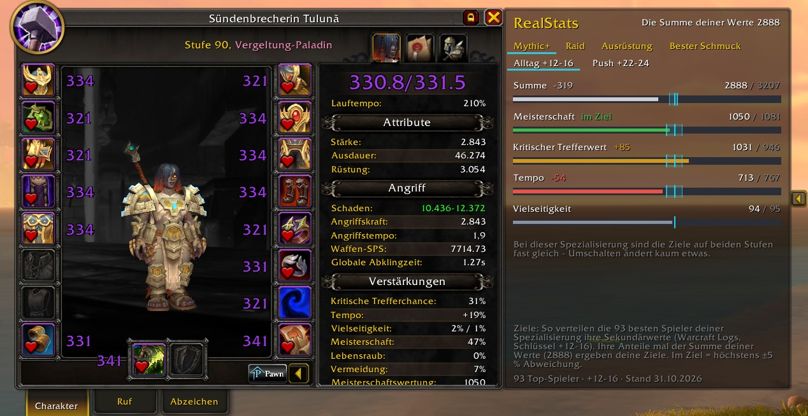
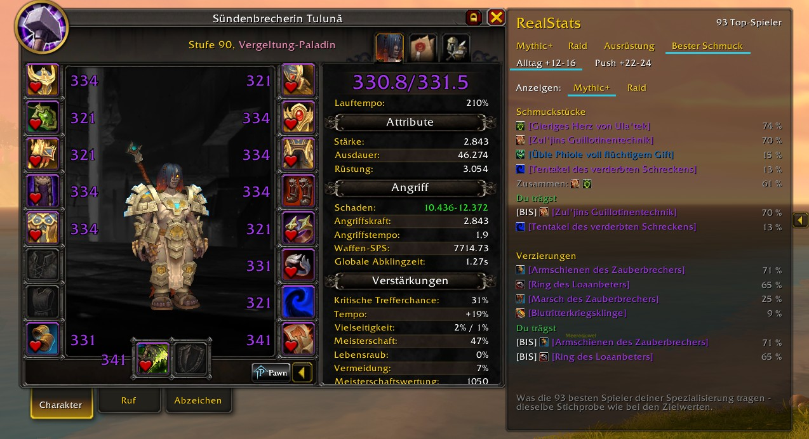
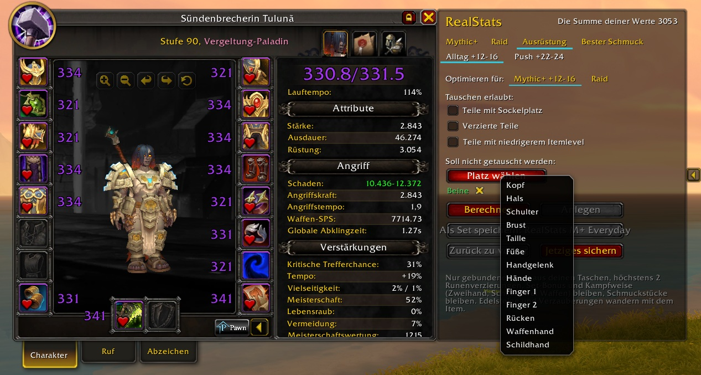
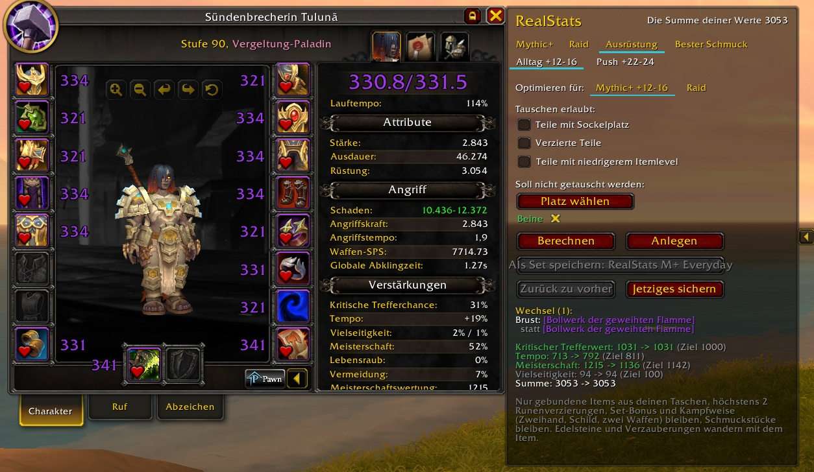
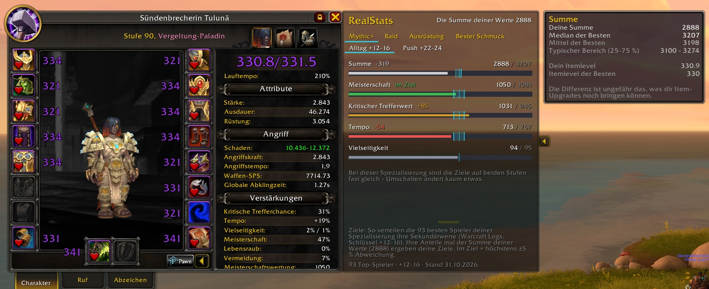
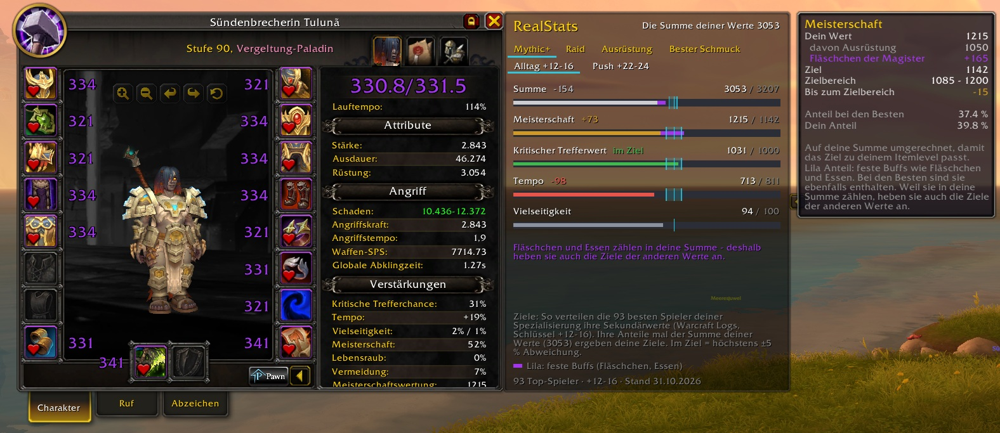

# RealStats

Compares your secondary stats with how the best players of your specialization
actually distribute theirs. Docks to the right of the character window.

## How the targets work

* The targets come from public top logs on Warcraft Logs: how the best players
  of your spec split Critical Strike, Haste, Mastery and Versatility.
* Their shares times **your stat total** give your targets, so they fit your item level.
* A stat is **in target** when it is within ±5 % of that value (cyan template).
* A stat the best players barely use (below 10 % share) only gets a guide line.
* The **Total** row compares your stat sum with the best players. The gap is
  roughly what item upgrades can still give you.
* Targets for every class and specialization, updated every week (Wednesday).

## Two key levels for Mythic+

The line above the bars switches between **Everyday keys** (+12-16) and
**Push keys** (the highest keys being run). The top logs come from players on
very high keys - if you run +12 to +16, the everyday level fits you better.
Everyday is preselected.

How much this matters depends on your specialization. For healers and tanks the
order of the stats can change completely (Holy Paladin, Preservation Evoker,
Restoration Shaman), for most damage dealers barely anything moves. When both
levels are nearly the same, RealStats says so, so nothing looks broken.

The choice is remembered per character and specialization and also applies to
the gear optimizer and the trinket tab.

## Tabs

* **Mythic+** and **Raid**: separate targets, because the best players gear
  differently for each.
* **Trinkets**: which trinkets the best players of your spec wear, in percent,
  next to what you wear yourself.
* **Embellishment**: which embellishments they use - the embellishment itself,
  not just the embellished item. With the most common combinations, what each
  one does, and where it actually sits. Below that, your own combination and
  how common it is.
  It also explains your **gem colours**: with the Loa Worshiper's Band, the
  colour of your gems decides which Loa you summon - Peridot calls Akil'zon
  (+75 haste), Amethyst calls Halazzi (damage), and every extra colour lowers
  the chance of getting the one you want. Nothing in the game tells you this.
* **BiS**: slot by slot, the item the best players of your spec wear most often
  and how many of them wear it. Slots where your gear differs come first, with
  your own item right below, so you see both side by side. No recommendation -
  a low share can simply be your item level, not a wrong choice. Rings and
  trinkets are treated as a pair, so a swapped ring is not reported as a
  difference. Hover a row for the full item tooltip.
* **Gear**: finds the combination of equipped items and items in your bags that
  comes closest to the targets, equips it with one click and saves it as an
  equipment set. Each key level gets its own set ("RealStats M+",
  "RealStats M+ Everyday", "RealStats Raid"), so they never overwrite each other.
  Only bound items, at most 2 embellishments, set bonus kept, weapon style kept
  (two-hander, shield, dual wield, ranged), trinkets stay.

### What may be swapped

Three check boxes, all in the same direction: ticked means the optimizer may
touch it, empty means it stays as it is. Saved per character **and** per
specialization. All three start empty, which is the careful setting:

* **Items with a socket** – otherwise a socketed item can be replaced by one
  without, and the gem is lost.
* **Embellished items** – left alone unless you allow it.
* **Items with lower item level** – without this tick every swap keeps or
  raises your item level, so no primary stat is lost for a nicer split.

### Keep single slots in place

Pick any slot — helmet, a ring, your weapon — and the optimizer leaves it alone
and balances over the remaining ones. Useful for a freshly socketed piece, a
favourite look or anything you simply do not want touched. Saved per character
and specialization, like the check boxes.

### Back to what you wore

Next to the set button: **Back to previous** re-equips what you wore before the
last change (the items have to be in your bags), and **Save current** stores your
current gear as the set "RealStats vorher" and as the way back.

## Fixed buffs

Flasks and food are part of your stats, just like for the best players. Their
share appears as a purple piece at the end of your bar, so you can see what
comes from your gear.

Because they count towards your stat total, they also raise the targets of the
**other** stats — a mastery flask lifts your crit target as well. RealStats says
so right under the bars whenever a fixed buff is active, so the numbers never
look like a miscalculation.

The tooltip works both ways: above the range it tells you how much to give
away, below it how much is missing. On the total line it compares your stat
total and item level with the best players.

## Performance & stability

* **Nothing runs during combat.** The window freezes and RealStats stops listening
  to stat, gear and buff events (tested: 3000 events in combat -> 0 refreshes).
* **No per-frame updates.** Bursts of events are merged into one refresh
  (tested: 1000 buff changes -> 1 refresh).
* The gear calculation only runs when you press *Calculate*.
* Values that WoW 12.x hides ("secret values") are handled without Lua errors.
* More than 300 automated checks run before every release.

## Usage

Open the character window – RealStats docks next to it. The arrow at its edge
collapses and expands it. No commands, no settings.

The window freezes during combat, so procs do not make the bars jump.

## Data and rights

Target data: [Warcraft Logs](https://www.warcraftlogs.com), public top logs.
Code © 2026 Tuluna. All rights reserved, see `LICENSE`.
